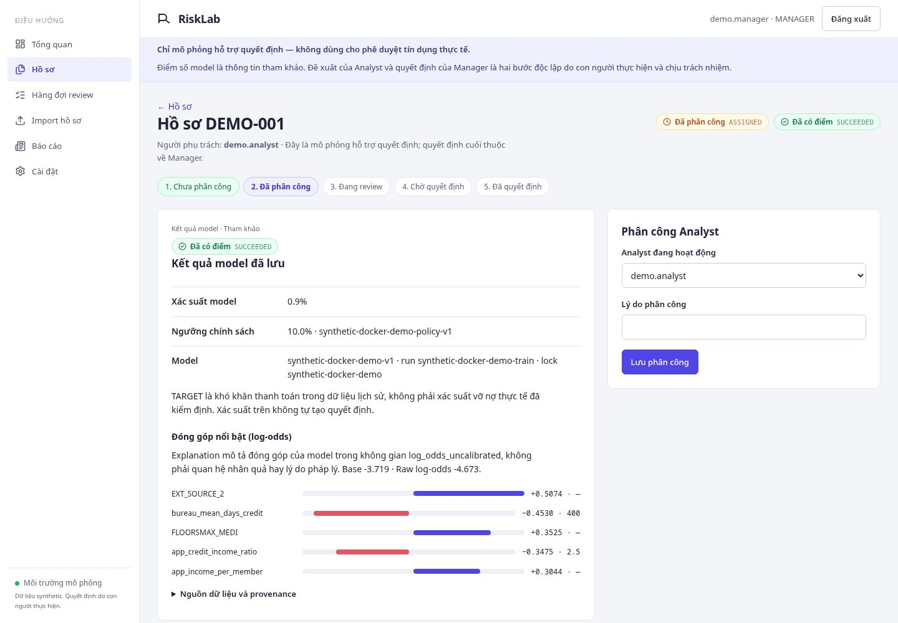
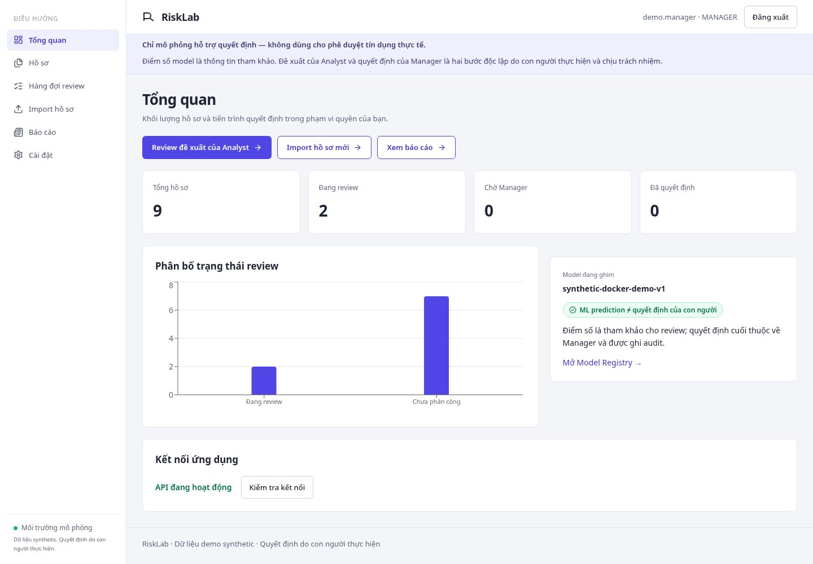
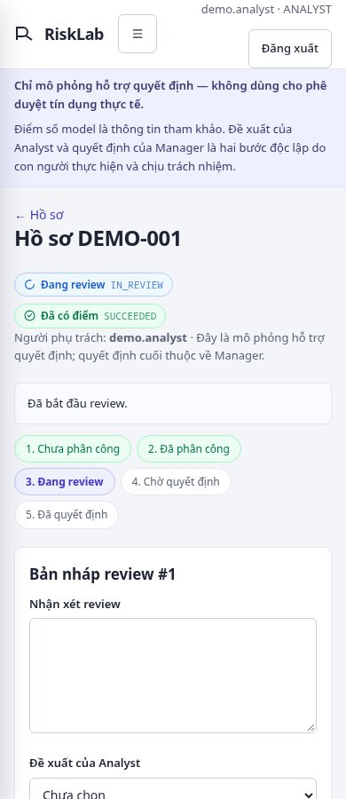
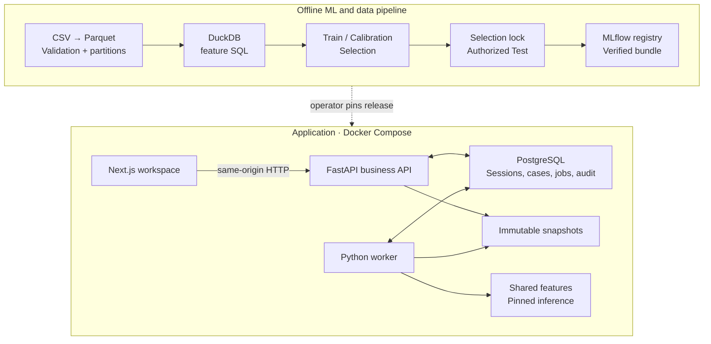

# RiskLab

**Credit-risk decision support — from raw data to an auditable human decision.**

[](https://github.com/hoangisreal/RiskLab/actions/workflows/ci.yml)

[Quick start](#quick-start) · [Architecture](#architecture) · [ML evidence](#ml-evidence) · [Documentation](docs/README.md)

RiskLab connects a full-stack review workspace to a reproducible tabular ML
pipeline. It combines **Next.js, FastAPI, PostgreSQL and a Python worker** with
**DuckDB, Parquet, scikit-learn and MLflow** to demonstrate how predictions
become reviewable, versioned evidence inside an application.

A Manager imports cases, a worker scores them, an Analyst reviews and proposes,
and a Manager makes the final decision. Predictions, proposals and decisions
remain separate records.

> This is a working, production-oriented demo. All lending decisions are
> simulated; it is not a production credit-decisioning system.



*Actual application screenshot with synthetic cases and a synthetic model.
The interface uses Vietnamese copy. [Screenshot provenance](docs/assets/README.md).*

<details>
<summary>More screenshots: dashboard and mobile review</summary>

**Manager workspace**



**Analyst review on mobile**



</details>

## Quick start

**Requirements:** Docker with Compose v2 and Make. No Kaggle account, GPU or
host Python installation is needed for the application demo.

```bash
git clone https://github.com/hoangisreal/RiskLab.git
cd RiskLab
make demo-up
```

Open **http://localhost:3000**. The stack initializes PostgreSQL, migrations,
three accounts, synthetic snapshots and a small synthetic LightGBM bundle.
The evaluated Home Credit research artifact and private datasets are not bundled.

| Role | Username | Demo-only password |
|---|---|---|
| Manager | `demo.manager` | `RiskLabDemo-Manager1` |
| Analyst | `demo.analyst` | `RiskLabDemo-Analyst1` |
| Admin | `demo.admin` | `RiskLabDemo-Admin1` |

**Try the workflow:** sign in as Manager → import
[`import-valid.csv`](tests/fixtures/business_v1/import-valid.csv) → wait for
`SUCCEEDED` → assign `demo.analyst` → sign in as Analyst and submit a proposal
→ sign back in as Manager to return or finalize the simulated decision.
Admin manages accounts without implicit access to credit decisions.

`make demo-logs` shows service logs; `make demo-down` stops the stack and keeps
its data. Demo passwords are configurable through `RISKLAB_DEMO_*_PASSWORD`
and must not be reused outside this loopback-only stack.

## Architecture



Training and MLflow run separately from the application. The worker verifies
its pinned release before scoring; the web UI does not train or promote models.
Batch and serving reuse the same cleaning and feature SQL.

| Engineering decision | What it protects |
|---|---|
| **Server-side role and object authorization** | Analysts access assigned cases; Managers alone finalize. Separation of duties survives role changes. Sessions and CSRF checks protect mutations. |
| **Transactional state changes and audit** | Row locks, revisions and import idempotency handle conflicts and retries. Predictions, submitted reviews and final decisions retain their history. |
| **PostgreSQL-backed jobs** | `SKIP LOCKED` claims, leases, heartbeats and attempt fencing prevent stale workers from committing. Execution is at least once. |
| **Explicit data contracts** | Unavailable history differs from confirmed empty history. Missing required sources block scoring rather than silently changing feature semantics. |
| **Verified model bundles** | Artifact, runtime, feature order and protocol checks bind inference to a known release. The registry path preserves evaluated bytes without a post-selection refit. |

The frontend uses TypeScript, React 19, Tailwind CSS 4, TanStack Table and
Recharts. The backend uses SQLAlchemy, Alembic and separate PostgreSQL roles
for API, worker and migration operations.

## ML evidence

### Frozen Home Credit model

LightGBM uses **147 inputs** from application, bureau, previous-application and
installment data. Preprocessing learns from Train only; Calibration, Selection,
Test and Monitoring have separate roles.

Historical locked evaluation on **46,127 Test applicants**:

| Metric | Value | 95% confidence interval |
|---|---:|---:|
| ROC-AUC | **0.7754** | 0.7676–0.7829 |
| PR-AUC | 0.2565 | 0.2456–0.2694 |
| Brier score | 0.06715 | 0.06657–0.06769 |
| Log loss | 0.24182 | 0.23949–0.24411 |

A fresh CPU reproduction recovered the **identical artifact SHA256**, exact
values across seven Train feature tables, and parity on **500 payloads**.
Recorded HTTP parity had a maximum probability difference of **0**.

These are research-artifact results, not metrics for the synthetic demo model.
[Results](docs/RESULTS.md) and the [model card](docs/model_card.md) provide
run/lock identities, subgroup results, limitations and all three recorded
historical Test openings.

### Broader comparisons and temporal validation

- **12 classifiers:** linear, tree, ensemble and neural baselines alongside
  LightGBM, XGBoost and CatBoost. Fixed budgets and paired intervals keep
  numerical gains distinct from a justified promotion. [Model comparison](docs/portfolio/model-comparison.md).
- **A separate chronological benchmark:** Home Credit Stability training data,
  forward validation and week-block uncertainty. Its limited 11-feature study
  reports weak results as well as successes; future-period labels remain
  unopened. [Temporal study](docs/portfolio/temporal-validation.md).
- **Operational ML checks:** source ablations, calibration and threshold
  analysis, drift simulations, audited promotion gates and rollback exercises.
  [Reproduction and verification](docs/portfolio/verification.md).

## Verification and development

```bash
make setup  # uv sync --locked; Python 3.12
make test   # Ruff, format, mypy and synthetic Python tests; Docker required
```

[GitHub Actions](.github/workflows/ci.yml) checks Python and real disposable
PostgreSQL, frontend lint/types/production build, Docker import-to-scoring smoke,
and Playwright desktop/mobile workflows. CI uses synthetic data; real-data
experiments run separately with recorded provenance.

For frontend development, use Node.js 24+ and the commands in
[apps/web](apps/web/README.md). To explore the implementation:

| Area | Entry point |
|---|---|
| Business API, roles and workflow | [src/risklab/business](src/risklab/business) |
| Data, features, experiments and model lifecycle | [src/risklab](src/risklab), [experiments](experiments) |
| Schema and database permissions | [migrations](migrations), [deploy](deploy) |
| Reproduction, GPU checks and local operations | [scripts](scripts), [documentation](docs/README.md) |

## Scope and limitations

The local application and automated checks are verified. Compose/Caddy,
release preflight and backup/restore tooling are provided; **VPS/TLS deployment,
an image-registry release and off-VPS recovery remain unverified**. CI does not
constitute production deployment acceptance.

The 2018 dataset contains approved loans from a static snapshot; payment
difficulty is not measured default loss. Its split is not out of time, and
subgroup metrics do not establish fairness. Explanations describe model
contributions, not causes. Monitoring is simulated, misses a documented mild
shift, and the indicative 100 ms concurrent p95 target was not met. The separate
temporal study has an unknown label horizon and limited predictors.

Raw borrower data, per-row predictions, credentials and local tracking stores
are excluded from Git. See [ML operations](docs/OPERATIONS.md) for research
setup and [verification](docs/portfolio/verification.md) for measured evidence.

## License

Code is available under the [MIT License](LICENSE). Dataset access and use
remain subject to the respective provider's terms.
