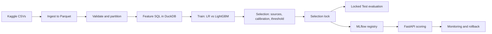
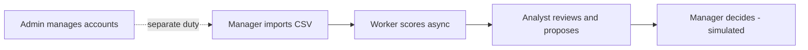

# RiskLab

[](https://github.com/hoangisreal/RiskLab/actions/workflows/ci.yml)


**Credit-risk decision support, built like a production system.** RiskLab scores
loan applicants on the Home Credit Default Risk dataset, then puts that score
through a human workflow: a Manager imports cases, a worker scores them, an
Analyst reviews and proposes, and a Manager alone makes the final — simulated —
decision. The model never decides.

> Production-oriented demo, not a production credit-decisioning system.
> Every decision in the app is labelled simulated; `approve`/`review` model
> output is illustrative only.

## Highlights

- **Leakage-safe ML protocol** — five disjoint partitions (Train / Calibration /
  Selection / Test / Monitoring), preprocessing fitted on Train only, and a
  content-bound selection lock. The served artifact is byte-identical to the
  evaluated artifact: no refit after selection.
- **Human-in-the-loop workflow** — server-side RBAC and separation of duties:
  Analysts propose, Managers decide, Admins manage accounts only. A reviewer
  can never decide their own case, even after a role change.
- **Auditable by construction** — every mutation and its audit event commit in
  one transaction; predictions, reviews and decisions are immutable and carry
  full model provenance (artifact hash, run ID, lock ID, feature contract).
- **Batch/online parity** — batch features (DuckDB over Parquet) and online
  scoring run the same cleaning code and the same SQL, verified on 500 payloads
  with a maximum probability difference of 0.
- **Honest evidence** — every metric carries its MLflow run ID; locked Test
  results, known limitations and failed checks are published, not hidden.

## Results

Final model: LightGBM, frozen by selection lock `17b83143e33bb907` before its
single locked Test evaluation for that lock (three Test openings in total,
each recorded in an append-only ledger).

| Locked Test metric (46,127 applicants) | Value | 95% CI |
|---|---:|---:|
| ROC-AUC | 0.7754 | [0.7676, 0.7829] |
| PR-AUC | 0.2565 | [0.2456, 0.2694] |
| Brier score | 0.0672 | [0.0666, 0.0677] |
| Log loss | 0.2418 | [0.2395, 0.2441] |

Test run `50d36f3b142a41039ff4d72967242f9a`. Full evidence, Selection
experiments and subgroup tables are recorded with the MLflow runs above.

On Selection, LightGBM beat Logistic Regression by +0.0132 ROC-AUC
(95% CI [0.0091, 0.0174]) under a rule declared in config before the experiment
ran. Historical sources earned their place the same way — bureau,
previous-application and installment features are served; bureau-balance, POS
and credit-card features are not. A later challenger study (XGBoost, CatBoost,
HistGradientBoosting) met no predeclared superiority rule, so the served model
is unchanged.

## How it works





| Partition | Share | Role |
|---|---:|---|
| Train | 55% | Fits preprocessing and models |
| Calibration | 10% | Fits calibrators only |
| Selection | 10% | Chooses model, sources, calibration, threshold |
| Test | 15% | Final evaluation of a locked selection only |
| Monitoring | 10% | Simulated drift batches; never trains |

## Quick start — Docker demo

Only Docker and Make are required:

```bash
make demo-up        # build and start, waiting for health checks
```

Open **http://localhost:3000** and sign in with a demo-only account
(passwords are fixed for this local stack, overridable via
`RISKLAB_DEMO_*_PASSWORD`, and must never be reused elsewhere):

| Role | Username | Password |
|---|---|---|
| Admin | `demo.admin` | `RiskLabDemo-Admin1` |
| Manager | `demo.manager` | `RiskLabDemo-Manager1` |
| Analyst | `demo.analyst` | `RiskLabDemo-Analyst1` |

**Three-minute walkthrough:** sign in as Manager → *Import hồ sơ* → upload the
synthetic CSV at `tests/fixtures/business_v1/import-valid.csv` → wait for
scoring `SUCCEEDED` → assign the Analyst → sign in as Analyst and submit a
proposal → sign back in as Manager and finalize the simulated decision.

```bash
make demo-smoke   # host Python: readiness, login, import-to-scoring check
make demo-logs    # follow service logs
make demo-down    # stop, keep data volumes
make demo-reset   # stop and delete demo volumes
```

The stack runs PostgreSQL, a one-shot `demo-init` (migrations, demo logins,
synthetic model bundle, demo accounts), the business API, the scoring worker
and the Next.js web app. Only ports 3000/8000 on loopback are published.

For host development (Python 3.12, Node.js 24, Docker):

```bash
make setup
cd apps/web && npm ci --ignore-scripts && cd ../..
make app-local
```

## Tech stack

| Layer | Technology |
|---|---|
| Web | Next.js 16, React 19, Tailwind CSS v4, TanStack Table, Recharts |
| API and worker | FastAPI, SQLAlchemy 2, Alembic, PostgreSQL |
| ML | LightGBM, scikit-learn, DuckDB, MLflow |
| Data | Parquet, YAML configs validated by Pydantic |
| Tooling | uv, Ruff, mypy, pytest, Playwright, Docker Compose, Caddy |

## Repository layout

| Path | Contents |
|---|---|
| [apps/web](apps/web) | Next.js frontend for the three roles |
| [src/risklab/business](src/risklab/business) | Business API, worker, scoring, accounts, audit |
| [src/risklab/api](src/risklab/api) | Versioned scoring API (contract 1.1) |
| [src/risklab](src/risklab) | ML pipeline: data, features, models, registry, monitoring |
| [configs](configs), [sql](sql) | Declarative configs and feature/validation SQL |
| [tests](tests) | Unit, integration, business and browser tests |
| [deploy](deploy) | Compose stacks, Caddyfile, release tooling |

## Verification

```bash
make test   # Ruff, format check, mypy, synthetic pytest gate
```

Latest recorded checks (2026-11-15): 698 Python tests passed on real
disposable PostgreSQL, frontend lint/typecheck/build passed, and browser E2E
covered the full import → review → decision workflow on desktop and mobile.

## Known limitations

- Static Kaggle snapshot with stratified holdouts; no absolute dates, so no
  reliable out-of-time validation. Approved loans only (reject-inference
  bias); `TARGET` is payment difficulty, not measured default or loss.
- Monitoring is simulated on a static pool with immediate labels; a mild age
  shift is missed at the frozen alert thresholds (disclosed, not hidden).
- Local latency is about 99 ms median per request, but the indicative 100 ms
  p95 target under concurrency is unmet. No production SLO is claimed.
- Subgroup performance varies (for example younger applicants show a higher
  false-positive rate under the global threshold). These are descriptive
  statistics, not fairness findings.
- VPS/TLS deployment, registry publication and off-VPS backup recovery are
  implemented as tooling but not yet verified on a target environment.

## Documentation

Detailed design documents, contracts and runbooks are maintained locally
with the project (product requirements, RBAC and workflow contracts, ML
evidence and operations guides). This README and the code are the public
entry points; key invariants are summarized in the sections above.

Raw data, row-level predictions and generated reports are never committed;
only aggregate reference hashes and metrics under `reports/reference/` are
tracked.

## License

[MIT](LICENSE)
