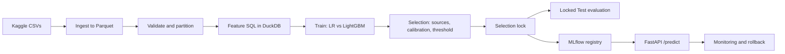

# RiskLab

[](https://github.com/hoangisreal/RiskLab/actions/workflows/ci.yml)

Credit risk prediction and model monitoring on the Home Credit Default Risk
dataset. RiskLab estimates the probability that an applicant will have
payment difficulties, serves that estimate through a versioned API, and
monitors it for drift — with a leakage-safe experiment protocol throughout.

This is a production-oriented demo, not a production credit-decisioning
system. The `approve`/`review` output is illustrative.

## Product scope and implementation status

The current repository implements the **ML/scoring foundation plus the local
application/identity foundation**, not yet the analyst/manager review workflow.
The agreed MVP is a credit-risk decision-support
simulation: Analysts review and propose, Managers alone finalize simulated
decisions, and Admins manage accounts without implicit business permissions.

The target stack is **Next.js, FastAPI, PostgreSQL and a Python worker**, deployed
on one Linux VPS with Docker Compose, Caddy HTTPS and GitHub Actions. This is a
modular monolith, not microservices. Public demo data defaults to synthetic.
The Next.js shell/login/Admin UI, PostgreSQL migrations, server sessions/RBAC and
account audit run locally; import/scoring jobs, business review/decision and VPS
delivery are **not implemented yet**. Follow the
[application guide](docs/development/application.md) for web setup; the quick start
below still runs the existing ML stack.

Start with the [Vietnamese documentation guide](docs/README.md),
[MVP PRD](docs/product/prd.md) and [acceptance criteria](docs/product/acceptance.md).
Coding agents should read [AGENTS.md](AGENTS.md). Advanced dashboards, Kubernetes,
Terraform, SSO and automated credit approval are outside this MVP.

**Evidence page:** [hoangisreal.github.io/RiskLab](https://hoangisreal.github.io/RiskLab/) — a static summary of the
recorded results below (source: [docs/index.html](docs/index.html)).

## Results

The final model was frozen on the Selection partition before the Test
partition was opened once, under a recorded selection lock. All metrics
carry their MLflow run ID in [docs/RESULTS.md](docs/RESULTS.md).

| Locked Test metric (46,127 applicants) | Value | 95% CI |
|---|---:|---:|
| ROC-AUC | 0.7754 | [0.7676, 0.7829] |
| PR-AUC | 0.2565 | [0.2456, 0.2694] |
| Brier score | 0.0672 | [0.0666, 0.0677] |
| Log loss | 0.2418 | [0.2395, 0.2441] |

Test run `50d36f3b142a41039ff4d72967242f9a`, lock `17b83143e33bb907`.

On Selection, LightGBM beat Logistic Regression by +0.0132 ROC-AUC
(95% CI [0.0091, 0.0174]) under a decision rule declared in config before
the experiment ran. Historical sources were admitted the same way: bureau,
previous-application, and installment features earned their place;
bureau-balance, POS, and credit-card features did not. A later challenger
study (E5, descriptive) compared XGBoost (0.7744), CatBoost (0.7733) and
HistGradientBoosting (0.7702) against the champion (0.7725): no challenger
met the predeclared superiority rule, so the served model is unchanged.
See [docs/RESULTS.md](docs/RESULTS.md) §9.

## How it works



Five disjoint partitions keep the protocol honest:

| Partition | Share | Role |
|---|---:|---|
| Train | 55% | Fits preprocessing and models |
| Calibration | 10% | Fits calibrators only |
| Selection | 10% | Chooses model, sources, calibration, threshold |
| Test | 15% | Final evaluation of a locked selection only |
| Monitoring | 10% | Simulated drift batches; never trains |

The served model is the evaluated model: the exact artifact frozen by the
selection lock is registered in MLflow and loaded by the API, with no refit
in between. Batch and online features run the same cleaning code and the
same SQL, verified by a 500-payload parity check with a maximum probability
difference of 0.

## Quick start

```bash
make setup
make test                       # synthetic data only; no Kaggle credentials required
# After accepting Kaggle competition rules and placing CSVs in data/raw:
make ingest
make partition
mkdir -p reports features data/duckdb_tmp data/monitoring
docker compose build train api
docker compose up -d mlflow
python scripts/run_selection.py # through verified candidate and Monitoring controls
```

Follow [docs/OPERATIONS.md](docs/OPERATIONS.md) for clean-tree locking,
registration, gated promotion, and API startup. Test evaluation is a
separate, explicitly authorized step. Credentials and admin keys stay in
the environment or in ignored local files.

## Documentation

| Document | Contents |
|---|---|
| [docs/README.md](docs/README.md) | Reading guide; current implementation vs target MVP |
| [docs/product/prd.md](docs/product/prd.md) | MVP scope and users; links to RBAC, workflow and acceptance |
| [docs/architecture/overview.md](docs/architecture/overview.md) | Target modular-monolith architecture (not implemented) |
| [docs/operations/deployment.md](docs/operations/deployment.md) | Target VPS delivery, security, CI/CD and backup links |
| [docs/PROJECT.md](docs/PROJECT.md) | Current ML architecture, data flow, module and config map |
| [docs/RESULTS.md](docs/RESULTS.md) | Accepted experiments, locked Test evidence, limitations |
| [docs/model_card.md](docs/model_card.md) | Model card for the served artifact |
| [docs/OPERATIONS.md](docs/OPERATIONS.md) | Setup, deployment, API, monitoring, reproduction |
| [docs/DECISIONS.md](docs/DECISIONS.md) | Historical ML decisions and current MVP scope decisions |
| [docs/PROGRESS.md](docs/PROGRESS.md) | Project status and follow-up investigations |
| [docs/data_contract.md](docs/data_contract.md) | Raw data contract and validation rules |
| [docs/api_contract.md](docs/api_contract.md) | API request/response contract 1.1 |
| [docs/archive/](docs/archive/) | Earlier detailed write-ups, superseded by the documents above |

## Known limitations

- Static Kaggle snapshot with stratified holdouts; there are no absolute
  dates, so no reliable out-of-time validation is possible.
- Approved loans only, so reject-inference bias applies. `TARGET` means
  payment difficulties, not measured default or loss.
- Monitoring is simulated on a static pool with immediate labels. A mild
  age shift is missed at the frozen alert thresholds; this is disclosed,
  with a probed-but-not-adopted sensitivity fix in
  [docs/DECISIONS.md](docs/DECISIONS.md) (D19).
- Latency: about 99 ms median for a single request locally, but the
  indicative 100 ms p95 target under concurrency is unmet. No production
  SLO is claimed.
- Subgroup performance varies (for example, younger applicants have a
  higher false-positive rate under the global threshold). These are
  descriptive statistics, not fairness findings; see the model card.

Raw data, row-level predictions, and generated reports are never committed.
Only aggregate reference hashes and metrics under `reports/reference/` are
tracked.
